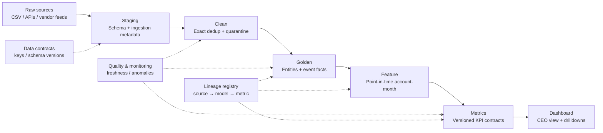

# Production Analytics Architecture

The production design separates immutable source evidence, schema-aware staging, deterministic cleaning, point-in-time golden entities, reusable features, governed metrics and a thin executive dashboard.

## Layer responsibilities

| Layer | Design / primary keys | Processing and controls |
|---|---|---|
| Raw | Immutable source object plus source_system, source_file, ingest_batch_id, ingested_at, schema_version and content hash. Preserve source primary key. | Append-only; never overwrite. Store event time and recorded/ingestion time separately. |
| Staging | One model per source; typed columns, source-local timestamps, normalized status strings. Natural source keys plus `source_system`. | Contract tests for required columns/types; additive nullable schema changes are monitored; breaking changes are versioned. |
| Clean | Exact duplicate-free rows, stable event keys, and separately queryable conflict quarantine. | Do not pick arbitrary latest payload for conflicting event IDs. Foreign-key orphan and status checks; preserve all rejected rows and reason codes. |
| Golden | `dim_account`, `dim_borrower`, `dim_agent`, `dim_campaign`, `fact_payment`, `fact_call`, `fact_channel_event`, `fact_ptp`, `fact_complaint`, `fact_account_status`. | SCD2 for borrower/account/agent/campaign/client/language and source mappings only when upstream effective-dated history is captured. Effective_from/effective_to plus recorded_from/recorded_to. Store payment-to-interaction only when the upstream relationship exists; never fabricate missing links. |
| Feature | Account × month or experiment unit; start-of-period eligibility, exposure, DPD, risk, vintage, prior touches and assignment. | Point-in-time join on both effective time and recorded time. Frozen feature snapshot per assignment/period; no future leakage. |
| Metrics | Versioned metric models with numerator, denominator, window, currency, exclusions and status. | Gross vs net collections separate; account count vs exposure separate; rates require frozen denominator and audited mappings. |
| Dashboard | One-screen CEO scorecard with drill-through to metric lineage and quality issue registry. | Show freshness, coverage and confidence next to every KPI. Disable unsupported rate/ROI cards rather than silently proxy them. |

## Incremental loads, late data and backfills

- Ingest with idempotent `source_system + source_event_id + source_version` keys and a monotonically increasing ingestion batch.
- Maintain an event-time watermark per source. Reprocess a rolling late-arrival window (initially 7 days, configurable from observed latency) and backfill any partition touched by a late or corrected event.
- Keep bitemporal columns: valid/effective time and system/recorded time. Historical “as known then” metrics must filter both clocks; corrected “latest truth” metrics must be separately labelled.
- A backfill is a new versioned run with `run_id`, source watermark, code commit, contract version, and row/hash reconciliation. Never mutate previously published results without a new metric version and restatement log.
- Rebuild month/account partitions where account status, campaign assignment or payment settlement changed. Reconcile gross success, reversals, settlements and bank totals after every payment backfill.

## Data quality, monitoring and lineage

Required monitors: schema drift; source freshness and late-arrival percentile; null/parse rates; exact duplicate rate; stable-key conflict counts; referential integrity; status transition anomalies; duplicate payment references; unmatched reversal rate; PTP maturity; call disposition mapping coverage; vendor mapping version coverage; orphan agent/account/borrower IDs; overlapping sessions; denominator population and coverage; cash-to-bank reconciliation; metric jumps and segment composition shift.

Anomaly alerts should use robust historical baselines (for example, median and median absolute deviation) only after enough comparable full periods exist; partial months are excluded. Alert on unexplained absolute INR movement, rate denominator movement, segment mix, source volume and late-data corrections. Each alert carries severity, evidence rows and a run/lineage ID.

Lineage records `source_table → staging_model → clean_model → golden_model → feature_model → metric_id → dashboard_component`, along with SQL hash, code commit, contract version, extraction timestamp and source watermark. Every dashboard number must expose the metric definition version and relevant quality tests.

## Release gates

Do not publish contact/RPC/PTP, recovery rate, channel conversion, agent-hour productivity, cost per ₹ recovered or ROI until the relevant mapping, denominator, linkage and cost contract passes. For the current synthetic challenge data those metrics remain unavailable by design.

## Current implementation versus target architecture

The Python build currently creates immutable-source file hashes, cleaned copies, conflict quarantine, latest-version borrower/agent snapshots, bitemporal month-start status, payment/call/channel facts, descriptive feature cuts and a generated `pipeline_manifest.json`. The full client/language/account exposure SCD2 and cost/settlement facts are target production requirements, not fields inferred from this challenge snapshot. `sql/` and `dbt_collections/` provide PostgreSQL-oriented implementation examples; the CSV pipeline remains the tested reference build.
